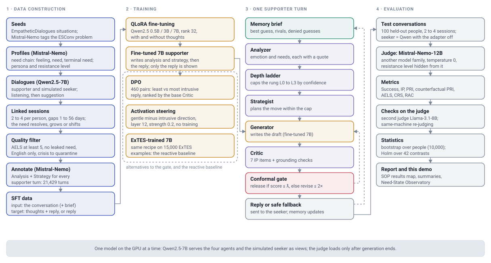
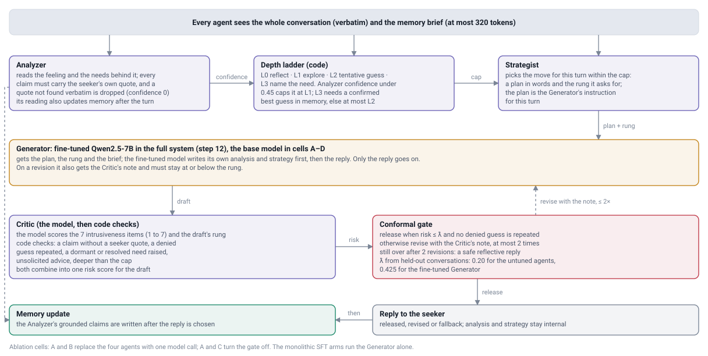
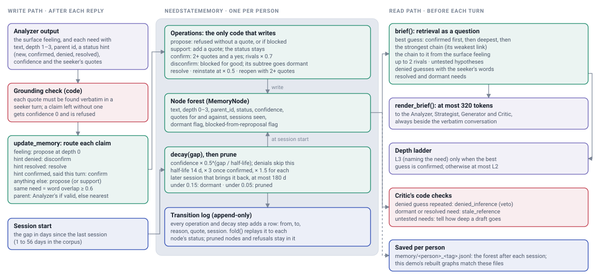
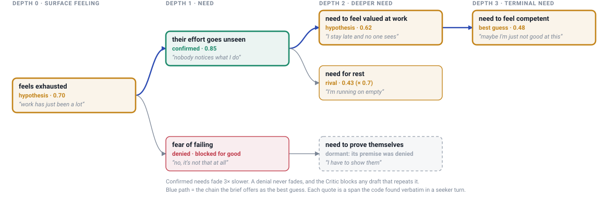
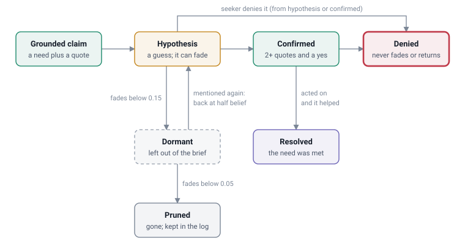

<div align="center">

# COCCON_NEW

### Proactive emotional support that looks for the need underneath, without getting ahead of the person

A four-agent supporter with a conformal safety gate and a belief memory that carries what it has learned
about a person from one session to the next, built entirely on open-weight models.


[Architecture](#architecture) ·
[Need-state memory](#the-need-state-memory) ·
[Results](#results) ·
[Quick start](#quick-start) ·
[Running the pipeline](#running-the-pipeline) ·
[Demo](#the-demo-need-state-observatory) ·
[Repository layout](#repository-layout)

</div>

---

## Contents

1. [What this is](#what-this-is)
2. [At a glance](#at-a-glance)
3. [Architecture](#architecture)
   - [The whole program](#the-whole-program)
   - [One supporter turn](#one-supporter-turn)
   - [The need-state memory](#the-need-state-memory)
4. [The four enhancements](#the-four-enhancements)
5. [Measuring intrusiveness and reactance](#measuring-intrusiveness-and-reactance)
6. [Results](#results)
7. [Quick start](#quick-start)
8. [Running the pipeline](#running-the-pipeline)
9. [The demo: Need-State Observatory](#the-demo-need-state-observatory)
10. [Repository layout](#repository-layout)
11. [Design rules the code enforces](#design-rules-the-code-enforces)
12. [Comparing against other corpora](#comparing-against-other-corpora)
13. [Corpus size](#corpus-size)
14. [Limitations](#limitations)
15. [Acknowledgements](#acknowledgements)

---

## What this is

People who reach out for support rarely say what they need. They say *"work has been a lot lately"*, and the
need underneath (to feel valued, to rest, to feel competent) comes out slowly, if at all. A supporter that
names it too early feels intrusive and the person pulls back. One that never looks for it stays on the
surface.

COCCON_NEW implements `SOP_12340340_12340370.pdf` / `PLAN.md` (scope: `modified_SOP_12340340_12340370.pdf`):
a proactive supporter that keeps looking for the need, paces how deep it goes, and checks every reply for
intrusiveness before the person sees it. It extends the COCOON framework with four enhancements:

| | Enhancement | In one line |
|---|---|---|
| **E1** | Multi-session English corpus | 1,000 seeded people, 2–4 linked sessions each with real time gaps, every supporter turn annotated with its Analysis and Strategy |
| **E2** | Multi-agent pipeline with a conformal gate | Analyzer, Strategist, Generator and Critic, a depth ladder, a typed grounding contract, and a gate calibrated to an intrusiveness budget |
| **E3** | Turn-level intrusiveness and reactance | the Intrusiveness Penalty (IP), the Psychological Reactance Index (PRI) and a counterfactual PRI that separates the supporter's effect from the seeker's mood |
| **E4** | Need-state memory | a graph of beliefs about needs, each backed by the person's own words, that fades, confirms, and remembers denials across sessions |

> **Scope note.** The modified SOP has four enhancements. Enhancement 5 (adaptive disclosure pacing) and its
> readiness value, privileged teacher and distillation stage were removed. The disclosure ladder itself
> remains, because Enhancement 2 caps depth with it. The memory-aware fine-tuning paths (Options B and C: a
> memory-aware corpus and an adapter trained on it) were dropped and their code removed; the fine-tuned model
> meets the memory only at inference (`sft7b_multi_mem`).

---

## At a glance

| | |
|---|---|
| **Corpus** | 1,000 profiles · 2,369 linked sessions · 21,429 annotated supporter turns |
| **Splits** | 720 train · 100 validation · 100 test · 80 calibration people |
| **Test set** | 100 held-out people, 2–4 sessions each (310 sessions per multi-session arm) |
| **Models** | Qwen2.5-7B-Instruct (generator, agents, simulated seeker) · Mistral-Nemo-12B (judge, another model family) · Llama-3.1-8B (second judge) |
| **Fine-tuning** | QLoRA (4-bit NF4, r 32, α 64) on Qwen2.5 0.5B / 3B / 7B, with and without the thoughts in the target |
| **Gate** | conformal risk control at α = 0.10 · λ̂ = 0.20 for the untuned agents, 0.425 for the fine-tuned Generator |
| **Statistics** | 95 % CIs by bootstrap over people (10,000 resamples) · Holm correction over 42 headline contrasts |
| **Hardware** | one RTX 3060 12 GB per run (one model resident at a time); RTX 4060 8 GB for the small sizes |

---

## Architecture

All diagrams below are drawn from the code. They are also in the demo's **Architecture** tab, where they
follow the page's light or dark theme.

### The whole program

Four stages, each a set of scripts that read files and write files. The corpus trains the supporter; the
supporter runs inside the four-agent pipeline with the gate and the memory; a separate judge scores every
conversation afterwards.

<picture>
  <source media="(prefers-color-scheme: dark)" srcset="docs/architecture/program-dark.svg">
  
</picture>

<details>
<summary><b>The four stages in words</b></summary>

1. **Data construction.** EmpatheticDialogues situations become seeds (Mistral-Nemo tags each with an ESConv
   problem type). Each seed becomes a profile with a hidden need chain (feeling, need, terminal need), a
   persona and a resistance level. Qwen2.5-7B plays both supporter and simulated seeker; sessions are linked
   2–4 per person with gaps of 1–56 days, and between sessions the person's need resolves, intensifies or
   shifts. A quality filter removes broken structure, leaked needs and non-English turns and quarantines
   crisis content. Mistral-Nemo then annotates every supporter turn with an Analysis and a Strategy.
2. **Training.** QLoRA on Qwen2.5 0.5B, 3B and 7B, with the Analysis and Strategy in the target and without
   them. Alternatives to the gate are trained from the same model: DPO on 460 preference pairs and
   activation steering. A 7B trained the same way on 15,000 ExTES examples is the reactive baseline.
3. **One supporter turn.** The memory brief, the Analyzer, the depth ladder, the Strategist, the Generator,
   the Critic and the conformal gate. See the next diagram.
4. **Evaluation.** 100 held-out people, 2–4 sessions each. The judge (Mistral-Nemo-12B, temperature 0, the
   resistance level hidden from it) scores Success, IP, PRI, counterfactual PRI, AELS, CRS and RAC. A second
   judge and same-machine re-judging check the judge. Bootstrap CIs over people, Holm over 42 contrasts.

</details>

### One supporter turn

The four agents are views of one model; only the Generator is fine-tuned. Each agent narrows what the next
may do: the Analyzer's confidence and the memory set the ladder's cap, the Strategist plans inside it, and the
Critic and the gate check the draft before the seeker sees anything.

<picture>
  <source media="(prefers-color-scheme: dark)" srcset="docs/architecture/turn-dark.svg">
  
</picture>

| Agent | Reads | Writes | Code |
|---|---|---|---|
| **Analyzer** | conversation + memory brief | the surface feeling and candidate needs, each with a quote from the seeker; a quote not found verbatim is dropped | `src/agents.py`, `src/grounding.py` |
| **Depth ladder** | Analyzer confidence + memory | the deepest rung allowed this turn | `src/pacing.py` |
| **Strategist** | Analyzer output, the cap, the brief | a plan in words and the rung it asks for | `src/agents.py` |
| **Generator** | plan, rung, brief, conversation | the reply (the fine-tuned model first writes its own analysis and strategy, which stay internal) | `src/agents.py`, `src/llm.py` |
| **Critic** | draft, Analyzer output, plan, denied needs | 7 intrusiveness item scores, the draft's rung, and code-level grounding violations | `src/agents.py`, `src/grounding.py` |
| **Conformal gate** | the Critic's risk score | release if risk ≤ λ̂ and no denied guess is repeated; otherwise revise (at most 2×), then a safe reflective fallback | `src/conformal.py`, `src/calibrate.py` |

**The depth ladder.** Every reply sits on one rung:

| Rung | Move | Allowed when |
|---|---|---|
| `L0` | reflect what was said | always |
| `L1` | explore with an open question | always |
| `L2` | offer a tentative guess at the need | Analyzer confidence ≥ 0.45 |
| `L3` | name the need | Analyzer confidence ≥ 0.45 **and** the memory's best guess is **confirmed** |

**The gate.** The Critic's risk score is 0.7 × its predicted IP + 0.3 × the weighted mass of grounding
violations. On held-out calibration conversations, `calibrate.py` picks the threshold λ̂ so that the share of
turns that are both released and intrusive (judge IP above τ = 0.2 on the 0–1 scale) stays under α = 0.10
with high probability (δ = 0.10). The guarantee holds only for drafts from the same generator and the same distribution, which
is why the fine-tuned Generator has its own calibration (λ̂ = 0.425).

### The need-state memory

The memory (`src/memory.py`) is one object per person. It holds **beliefs about needs, not facts**. Writes
come only from the Analyzer's grounded claims, after the reply is chosen. Reads happen before the next turn:
a short brief for the prompts, plus the denied and stale needs the Critic checks against. Every change is a
row in an append-only log, so any belief can be explained afterwards.

<picture>
  <source media="(prefers-color-scheme: dark)" srcset="docs/architecture/memory-dark.svg">
  
</picture>

**The belief graph.** Each node is a need with a status, a confidence and the seeker's own words as
evidence. Edges run from a need to the shallower need it explains; siblings are rival explanations. The
example shows every status at once; the blue path is the chain the brief offers as the best guess.

<picture>
  <source media="(prefers-color-scheme: dark)" srcset="docs/architecture/graph-dark.svg">
  
</picture>

<table>
<tr>
<td width="50%" valign="top">

**How a belief changes.** Only a claim with a quote enters. A denial is final: the guess is blocked from
being proposed again and everything below it goes dormant.

<picture>
  <source media="(prefers-color-scheme: dark)" srcset="docs/architecture/life-dark.svg">
  
</picture>

</td>
<td width="50%" valign="top">

**Decay across sessions.** At each session start every belief except a denial fades by
0.5<sup>gap / half-life</sup>. A need that keeps coming back lasts longer.

<picture>
  <source media="(prefers-color-scheme: dark)" srcset="docs/architecture/decay-dark.svg">
  
</picture>

</td>
</tr>
</table>

**The rules, with their values** (`configs/default.yaml`, `memory:`):

| Rule | Value |
|---|---|
| Same need? | word overlap (Jaccard on content words) ≥ 0.6 |
| Confirm | at least 2 quotes and an explicit yes in the seeker's latest turn; confidence rises to ≥ 0.85 |
| Rival needs | when one sibling is confirmed, the others drop to × 0.7 |
| Deny | confidence 0, blocked from re-proposal for good, the subtree goes dormant |
| Reopen a denial | only with at least 2 new quotes |
| Half-life | 14 days; × 3 once confirmed; × 1.5 for every later session that brings the need back; at most 180 days |
| Dormant | under 0.15: left out of the brief; mentioned again, it comes back at half confidence |
| Pruned | under 0.05: removed from the graph (kept in the log); a held child is re-hung on its grandparent |

**What the agents see: the brief** (at most 320 tokens, always beside the verbatim conversation, never
instead of it). Retrieval works as a question, not a lookup: the brief says what the system does *not* know
yet.

| Part of the brief | What it carries |
|---|---|
| Best guess and its chain | the best terminal need still in play (confirmed first, then deepest, then the strongest chain) and the path to it from the surface feeling |
| Rivals | up to two other candidate terminal needs, so more than one explanation stays open |
| Untested links | hypotheses not yet confirmed or denied: what a gentle question could check next |
| Forbidden inferences | every denied guess with the seeker's own words; the Critic vetoes any draft that repeats one |
| Resolved and dormant | needs already met, and beliefs that faded out of the brief |

---

## The four enhancements

| Enhancement | What it is | Where it lives |
|---|---|---|
| E1 | English proactive corpus with multi-session temporal structure | `src/seeds.py`, `src/profiles.py`, `src/dialogue.py`, `src/sessions.py`, `src/filter.py`, `src/annotate.py` |
| E2 | Multi-agent pipeline, typed grounding contract, conformal critic gate | `src/agents.py`, `src/grounding.py`, `src/conformal.py`, `src/calibrate.py` |
| E3 | Turn-level Intrusiveness Penalty and Psychological Reactance Index | `src/metrics.py`, `src/counterfactual.py`, `human_eval/` |
| E4 | Need-state trajectory memory (belief, not facts) | `src/memory.py`, `src/baselines/memory_*.py` |
| Fine-tuning | QLoRA SFT with Analysis/Strategy in the target, plus the `w/o thoughts` arm | `src/build_sft.py`, `src/train.py` |
| Depth ladder | L0–L3 cap used by the Strategist and the `overreaching_depth` check (part of E2, not a pacing policy) | `src/pacing.py` |
| Alternatives | DPO and activation steering, compared against the gate | `src/preference.py`, `src/steering.py` |
| Evaluation | arm runner, instruments, statistics, guarded reporting | `src/evaluate.py`, `src/judge.py`, `src/report.py` |

---

## Measuring intrusiveness and reactance

All judge scores are on 0–1. For IP and PRI, **higher is worse**.

<table>
<tr>
<th width="50%">Intrusiveness Penalty (IP): the supporter's turn</th>
<th width="50%">Psychological Reactance Index (PRI): the seeker's next turn</th>
</tr>
<tr>
<td valign="top">

1. gave advice before the seeker had finished explaining
2. asserted a feeling or motive the seeker had not expressed
3. named a need or cause the seeker had not acknowledged
4. pressed for information the seeker was reluctant to give
5. interpreted more deeply than the seeker had invited
6. disregarded a boundary the seeker had set
7. likely to feel exposing rather than supportive

</td>
<td valign="top">

1. sounds irritated or annoyed with the supporter
2. tone is hostile or sharp
3. counter-argues the supporter's framing
4. dismisses what the supporter offered
5. asserts autonomy or competence against the supporter
6. deflects or changes the subject
7. withdraws: markedly shorter or more closed than before

</td>
</tr>
</table>

- **Counterfactual PRI** (`src/counterfactual.py`): the seeker's reply is regenerated after a neutral
  reflective control turn in place of the supporter's turn, from the same prefix. Factual minus control PRI is
  the reactance the supporter's turn caused, net of the seeker's mood.
- **Session scales:** Success (did the person feel helped), AELS (active listening), CRS (comforting
  responses: Aff / Neg), RAC (Sup / Man) and the six basic metrics, from the prompts in `prompts/scale_*.md`.
- **Judge controls:** the judge is another model family than the generator and the simulator
  (`src/report.py` refuses to print otherwise), runs at temperature 0, and never sees the resistance level.
  The 7 IP items live in one file (`prompts/metric_ip.md`, mirrored in the Critic's prompt), so the thing
  being gated and the thing being measured cannot drift apart.

---

## Results

Full results with every caveat: [`results/v3_full1000/README.md`](results/v3_full1000/README.md). Each SOP
item mapped to its folder: [`results/SOP_RESULTS_MAP.txt`](results/SOP_RESULTS_MAP.txt). Plain-text summaries
per study: [`temp_results/`](temp_results/).

### Main arms

100 held-out people; multi-session arms have 310 sessions. Means with 95 % bootstrap CIs over people.

| Group | System | Success ↑ | IP ↓ | PRI ↓ |
|---|---|---|---|---|
| Baselines | Base model, proactive seeker | 0.383 [0.368, 0.402] | 0.065 [0.057, 0.072] | 0.192 |
| | Base model, reactive seeker | 0.415 [0.398, 0.432] | 0.089 [0.081, 0.097] | 0.190 |
| 2 × 2 | **A** one call | 0.382 [0.372, 0.392] | 0.068 [0.063, 0.073] | 0.184 |
| | **B** one call + gate | 0.375 [0.365, 0.387] | **0.061** [0.057, 0.064] | 0.187 |
| | **C** four agents | 0.379 [0.367, 0.392] | 0.087 [0.081, 0.093] | 0.203 |
| | **D** four agents + gate | 0.369 [0.360, 0.381] | 0.072 [0.067, 0.077] | 0.194 |
| Full system | Step 12: D + fine-tuned Generator + memory | 0.380 [0.369, 0.392] | 0.096 [0.091, 0.102] | 0.245 |
| Fine-tuning | Fine-tuned 7B, with thoughts | 0.415 [0.395, 0.433] | 0.091 [0.083, 0.097] | 0.241 |
| | Fine-tuned 7B, without thoughts | 0.392 [0.373, 0.410] | 0.083 [0.075, 0.092] | 0.223 |
| | Fine-tuned 7B + need-state memory | 0.394 [0.383, 0.404] | 0.092 [0.087, 0.098] | 0.255 |
| | Fine-tuned 7B, no memory | 0.380 [0.370, 0.392] | 0.090 [0.084, 0.096] | 0.252 |
| Memory (untuned, 4 agents) | No memory | 0.376 | 0.099 | 0.259 |
| | Flat summary | 0.369 | 0.103 | 0.248 |
| | Dense retrieval | 0.361 | 0.116 | 0.254 |
| | Need-state graph | 0.371 | 0.116 | 0.265 |
| Alternatives | SFT control → **DPO** | 0.377 → 0.387 | 0.088 → **0.061** | 0.213 → 0.212 |
| | Steering control → activation steering | 0.405 → 0.404 | 0.085 → 0.076 | 0.203 → 0.214 |
| Corpus comparison | ExTES-trained 7B, ExTES people | **0.517** [0.492, 0.543] | 0.109 | 0.301 |
| | Our-corpus 7B, ExTES people | 0.453 [0.435, 0.475] | 0.108 | 0.324 |

### What the numbers say

- **The gate works where it is calibrated.** With four agents it lowers IP (D − C = −0.015, survives Holm).
  The share of turns released and intrusive (IP > 0.2) stays under the α = 0.10 budget: 0.046 for cell D,
  0.091 for step 12.
- **Decomposition alone costs intrusiveness.** Four agents raise IP over one call (C − A = +0.020,
  D − B = +0.012, both Holm), with no Success difference anywhere in the 2 × 2.
- **DPO gives the largest IP drop of any method** (−0.027 vs its SFT control, Holm) at no extra calls per
  turn. Activation steering lowers IP by 0.008 (not Holm).
- **Memory does not move Success.** On the fine-tuned 7B it adds +0.014 Success (0.394 vs 0.380, mostly in
  sessions 2–4) with the same IP. On ES-MemEval question answering the need-state memory scores 0.619.
- **The ExTES-trained model wins on ExTES people** (Success +0.063, Holm). On our people it is ahead by
  +0.037 (not significant) with the same IP.
- **The thoughts carry information:** 8.9 / 7.4 / 3.3 bits per reply for 0.5B / 3B / 7B (PVI). On the 7B
  they add Success +0.023.
- **9 of 42 headline contrasts survive Holm.**

### Read them with care

- Step 12 ran on the transformers backend, cells A–D on Ollama; the backend alone adds about +0.017 IP.
- Out of distribution (ExTES people) the gate stays under α only by falling back on 65 % of turns.
- The seekers are simulated (Qwen2.5-7B) and the scores come from one LLM judge. The second judge
  (Llama-3.1-8B) keeps the sign of every IP conclusion except the need-state memory's rise.
- **Judge-human agreement has not been collected yet.** The sampler and the agreement script are ready in
  `human_eval/`.

---

## Quick start

```bash
python -m venv .venv && source .venv/bin/activate
pip install pyyaml numpy                 # enough for the checks and all file-level logic
pip install -r requirements.txt          # add this when you want real inference or training
python tests/test_all.py                 # component checks on the echo backend: no GPU, no network
```

`configs/models.yaml` ships with `backend: echo`: deterministic stubs, no GPU. Switch to `ollama`,
`transformers` or `vllm` when you have the hardware; nothing else changes.

| Backend | Use it for | Notes |
|---|---|---|
| `echo` | tests, wiring checks | deterministic stubs, no model |
| `ollama` | generation and judging on one GPU | plain HTTP to `http://localhost:11434`, no Python client; serves GGUF, cannot train |
| `transformers` | training, the fine-tuned supporter, steering | loads base + LoRA adapter, switches the adapter on and off per role |
| `vllm` | batched serving | optional; drop it on small GPUs |

**Ollama.** Install with `curl -fsSL https://ollama.com/install.sh | sh` (or https://ollama.com/download),
then `python scripts/fetch_data.py --ollama` to pull the tags in `configs/models.yaml`: `qwen2.5:7b-instruct`
for the generator, simulator and agents, and `mistral-nemo:12b-instruct-2407-q4_K_M` for the judge. Set
`backend: ollama`. `release()` sends `keep_alive: 0`, so the one-model-at-a-time rule holds on a 12 GB card.
`src/train.py` always runs on transformers; serving the fine-tuned supporter through Ollama would mean merging
the adapter, converting to GGUF with llama.cpp and `ollama create`, so run supporter arms on
`backend: transformers`.

**Data and weights.**

```bash
python scripts/fetch_data.py --self-check     # download-parsing checks, no network
python scripts/fetch_data.py --all --map      # datasets into data/raw + data/external
python scripts/fetch_data.py --models         # weights (large; Mistral-Nemo is gated)
```

---

## Running the pipeline

### One command for everything

On a fresh GPU machine, `scripts/full_run.sh` does the setup (venv, Ollama and models, the fine-tuning base
weights, configs) and then runs every phase through `run_all.py`:

```bash
./scripts/full_run.sh smoke                                # ~10 min wiring check in a throwaway copy; run it first
N_PROFILES=1000 WORKERS=8 ./scripts/full_run.sh dataset    # stop once the dataset is built
N_PROFILES=1000 WORKERS=8 ./scripts/full_run.sh            # everything; rerun the same command to resume
```

Order: dataset (seeds, profiles, sessions, filter, annotate, SFT files) → fine-tuning (with / without
thoughts) → test the fine-tuned supporters → gate calibration + baselines → report. The dataset lands in
`data/corpus/` (annotated multi-session dialogues) and `data/sft/` (training and validation files).

```bash
python scripts/run_all.py --scale smoke                       # minutes, echo backend, proves the wiring
python scripts/run_all.py --scale pilot --backend ollama      # 100 profiles, 20 dialogues per arm
python scripts/run_all.py --scale full  --backend ollama --train
python scripts/run_all.py --scale full --dry-run              # print the 60-odd steps, run nothing
python scripts/run_all.py --only eval,score,report --run-dir runs/<id>
```

Each stage runs as its own subprocess, so the generator's weights are gone before the judge loads, and a
crashed stage is one command to repeat. `runs/<id>/pipeline_state.json` records what finished, so rerunning
resumes; `--force` overrides, `--keep-going` pushes past a failure. `runs/<id>/pipeline.log` holds per-stage
wall clock, and the run ends with a timing summary.

By default the runner evaluates the baselines and the 2 × 2 (`base_instruct`, `reactive_baseline`,
`cellA`–`cellD`, on the base model through Ollama) and, with `--train`, the two fine-tuned supporters on the
adapters it just trained (transformers backend). `--arms all` runs every arm in `configs/arms.yaml`. The gate
is calibrated on the calibration profiles (`calib_dec_ungated`), never on the test profiles.

The ablations are arms, not bespoke scripts: the annotation ablation (`sft_with_thoughts` vs
`sft_wo_thoughts`), the 2 × 2 of decomposition × gate (`cellA`–`cellD`), the memory arms (`mem_*`), the
fine-tuned 7B with and without memory (`sft7b_multi_mem`, `sft7b_multi_nomem`), and the corpus comparison
(`corpus_*`). `src/report.py` then writes `reports/results.md` with the per-arm table, the 2 × 2 main effects
and interaction, the risk-coverage frontier, and paired-bootstrap CIs.

### Stage by stage

```bash
python src/seeds.py     --limit 100                          # pilot first: gate G1 decides the route
python src/profiles.py  --limit 100 --split
python src/dialogue.py  --limit 100
python src/sessions.py  --limit 100
python src/sessions.py  --check                              # temporal integrity
python src/filter.py
python src/annotate.py

python src/build_sft.py --arm with_thoughts
python src/build_sft.py --arm wo_thoughts
python src/train.py     --arm with_thoughts                  # needs a GPU

python src/evaluate.py  --arm cellC_dec_ungated --limit 30   # ungated dialogues for calibration
python src/calibrate.py --dialogues runs/<id>/dialogues/cellC_dec_ungated.jsonl
python src/evaluate.py  --arm cellD_dec_gated --run-dir runs/<id>

python src/metrics.py        --dialogues runs/<id>/dialogues/cellD_dec_gated.jsonl
python src/counterfactual.py --dialogues runs/<id>/dialogues/cellD_dec_gated.jsonl

python human_eval/sample.py    --run runs/<id> --metric ip   # then two people fill the sheets
python human_eval/agreement.py --run runs/<id> --metric ip
python src/report.py --run runs/<id>
```

Scoring is always a separate pass from generation: the judge is a different model and must not be
co-resident with the generator.

### Talk to it

```bash
python scripts/chat.py                  # fine-tuned 7B, one call, no memory
python scripts/chat.py --memory         # + need-state memory, written by the base Analyzer
python scripts/chat.py --agents         # the full system: four agents, gate and memory (step 12)
python scripts/chat.py --no-adapter     # the same, on the untuned base model
```

---

## The demo: Need-State Observatory

A web page that shows the system at work: a conversation, the need-state graph changing turn by turn beside
it, an inspector for every supporter turn, the results, and the architecture diagrams above.

```bash
python3 demo/build_data.py                       # once: results -> demo/static/data/replay.json (CPU, ~15 s)
python3 demo/server.py                           # replay only, any machine -> http://127.0.0.1:8765
python3 demo/server.py --live --backend ollama   # + live chat on a GPU machine with Ollama
```

| View | What it shows |
|---|---|
| **Conversation, Replay** | recorded test conversations of the full system and of the untuned agents with memory; the graph is rebuilt turn by turn through the project's own memory code (725/725 and 785/785 nodes match the saved files) |
| **Conversation, Live** | type as the seeker or let a simulated test person talk; "Next session" applies decay over the gap you set |
| **Results** | every arm's Success / IP / PRI / counterfactual PRI / AELS with CIs, the gate's calibration, recovery against cost, the 42 Holm-corrected contrasts |
| **Architecture** | every diagram in this README, in the page's theme |
| **How it works** | the pipeline, the ladder, the IP items, the memory rules, and the caveats |

Standard library only on the server side. Details: [`demo/README.md`](demo/README.md).

---

## Repository layout

```
COCCON_NEW/
├── src/                 the pipeline (flat: modules import each other by bare name)
│   └── baselines/       one-call listener and the memory baselines (none, summary, dense, event)
├── extra/               analyses beyond the SOP, run on what the pipeline wrote
├── scripts/             run_all.py, full_run.sh, fetch_data.py, chat.py, comparison and summary scripts,
│                        and the per-machine queue scripts that produced the current results
├── configs/             models.yaml · arms.yaml · default.yaml
├── prompts/             every agent, simulator, annotation and judge prompt
├── reference_cocoon/    the upstream COCOON prompts kept for reference
├── tests/               test_all.py: component checks on the echo backend
├── human_eval/          rating-sheet sampler and agreement statistics
├── demo/                Need-State Observatory (server.py, build_data.py, static/)
├── docs/architecture/   the diagrams in this README, light and dark
├── data/                seeds, profiles, corpus, SFT files, external sets
├── results/             tracked results; v3_full1000/ is the 1000-profile run
└── temp_results/        one folder per study: plots and plain-text summaries
```

| Folder | What it holds |
|---|---|
| `src/` | data construction, fine-tuning, agents, gate, memory, judge, metrics, report ([`src/README.md`](src/README.md)) |
| `extra/` | analyses beyond the SOP: seeker states, Markov and survival models of disclosure, conformal need sets, psychometrics, memory calibration, ES-MemEval, PVI, LoRA geometry, scaling ([`extra/README.md`](extra/README.md)) |
| `scripts/` | `run_all.py` and `full_run.sh` (the whole pipeline), `fetch_data.py` (datasets and weights), `collect_results.sh` (copies results from `runs/` into `results/`), `chat.py`, the comparison and summary scripts, and the queue scripts |
| `results/` | `results/v3_full1000/` is the 1000-profile run; `results/SOP_RESULTS_MAP.txt` maps each SOP item to its folder; `results/EXTRA_STUDIES.txt` lists the added work |
| `temp_results/` | one folder per study with plots and plain-text summaries, built by `extra/build_temp_results.py` |

The queue scripts in `scripts/` (`sop_queue.sh`, `queue_104.sh`, `sft_agents.sh`, …) wait for jobs on a
named lab machine. They are kept as the record of how each result was produced, not as tools for a new
machine; use `run_all.py` or `full_run.sh` there.

---

## Design rules the code enforces

1. **Every stage reads files and writes files.** A stage is one script; rerunning it costs only that stage.
2. **One model resident at a time.** `llm.LLM` raises `ResidencyError` on a second distinct model. Several
   conversational roles share one resident model through `LLM.view(role)`.
3. **Structured output augments, never replaces, raw history.** Every agent and judge prompt contains the
   verbatim turns.
4. **Nothing enters belief state ungrounded.** `grounding.validate_span` gates every memory write.
5. **Resumable.** Stages skip ids already present in their output file.
6. **No proprietary API anywhere.** There is no code path that can call one.

**What the report refuses to print.** `src/report.py` fails rather than footnoting when a cell has no sample
size, when the judge model equals the supporter's or the simulator's, or when an out-of-distribution result
is described as a guarantee, and it marks any IP / PRI headline that has no judge-human agreement figure yet.

---

## Comparing against other corpora

The baseline paper's comparison (its Tables 3 and 4) fine-tunes one base model on each corpus and scores every
resulting supporter on the same profiles. Here it is reproduced as arms:

```bash
python src/convert_corpus.py --set extes --raw data/raw/extes.json     # -> data/sft/corpus_extes_*.jsonl
python src/train.py --arm corpus_extes --out runs/<id>                 # the ExTES reactive baseline
# put the adapter path into configs/arms.yaml -> adapters:
python src/evaluate.py --arm corpus_extes --arm sft_with_thoughts --run-dir runs/<id>
```

`--train` in `scripts/run_all.py` does the convert-and-train steps for ExTES when its raw file is present. The
report then prints a **Training-corpus comparison** table with the paper's columns: SR, Basic Avg (the six
basic metrics rescaled to 0–100), and Aff / Neg / Sup / Man, for our profiles and for the ExTES profiles.

Two asymmetries are printed with it: corpora other than ours carry no Analysis / Strategy annotation, so their
adapters train response-only (the same condition as our `w/o thoughts` arm); and the item groupings behind
Aff / Neg / Sup / Man are ours, listed in `src/metrics.py`, because the published instruments define items,
not groupings.

---

## Corpus size

COCOON reports **3.5k dialogues at 18.82 average turns** (their Table 1, Chinese, single-session). Nothing in
this code caps corpus size: the only limits are config values, and every stage resumes, so raising them and
rerunning costs only the new records.

| Knob | Default | Effect |
|---|---|---|
| `corpus.n_profiles_target` | 1000 | profiles attempted; ~1000 × 3 sessions × ~0.65 filter survival ≈ 2k sessions (sized to one 12 GB GPU; 2000 gives ~3.9k) |
| `corpus.sessions_per_profile` | [2, 4] | sessions per linked sequence |
| `corpus.turns_per_session` | [8, 12] | supporter turns, so 16–24 total turns per session |
| `eval.n_dialogues_per_arm` | 150 | evaluation only; does not touch corpus size |

Seed supply is not the constraint: EmpatheticDialogues has ~19.5k unique situations, and `seeds.py` pulls
2 × target candidates before screening. The real constraint is generation time: roughly 3–5k output tokens
per session, so ~3k generated sessions is ~10–15M output tokens plus judging.

---

## Limitations

- **No human ratings yet.** Every IP / PRI number is an LLM judge's; judge-human agreement is the one SOP item
  not done (`human_eval/` is ready for 2–3 raters).
- **Simulated seekers.** Qwen2.5-7B plays every person; real people may resist differently.
- **One judge machine matters.** The judge's serving machine shifts session-level scales a lot and IP a little
  (0.068 vs 0.079); comparisons in the results are re-judged on one machine where it mattered.
- **The guarantee is in-distribution.** On ExTES people the gate meets its budget only by falling back on 65 %
  of turns.
- **Memory is not yet a win.** No memory type moves Success; memory raises IP slightly in the untuned agents.

---

## Acknowledgements

`reference_cocoon/` holds the five upstream COCOON files kept as reference: the Chinese proactive speaker
prompt (the behavioural spec for our English simulator), the English reactive speaker prompt (our reactive
baseline), and the AELS / Comforting-Responses / RAC scale prompts, cross-checked against our own in
`prompts/`. No upstream Python is used: it assumes GPT-4o, hardcodes internal cluster URLs and author-absolute
paths, and is Chinese-first.

Data: EmpatheticDialogues (seeds), ESConv (problem types and the data-quality comparison), ExTES (the second
corpus and distribution shift), ES-MemEval (memory question answering), EmoBench (emotional intelligence).
Scorer for the paper's Table 6: ESC-RANK.
