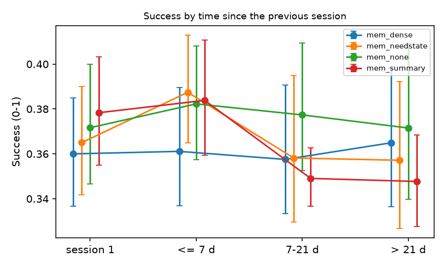

# Memory metrics without a model - memory_v2

## 1. Success Rate by time since the previous session

Judge Success per session (0-1), grouped by the gap before it. 95 % CI: bootstrap over profiles.

| arm | memory | session 1 | <= 7 d | 7-21 d | > 21 d |
|---|---|---|---|---|---|
| mem_dense | dense | 0.360 [0.337, 0.385] (n=100) | 0.361 [0.337, 0.390] (n=90) | 0.358 [0.333, 0.391] (n=62) | 0.365 [0.337, 0.398] (n=58) |
| mem_needstate | needstate | 0.365 [0.342, 0.390] (n=100) | 0.387 [0.365, 0.413] (n=114) | 0.358 [0.330, 0.395] (n=47) | 0.357 [0.327, 0.392] (n=49) |
| mem_none | none | 0.372 [0.347, 0.400] (n=100) | 0.382 [0.357, 0.408] (n=109) | 0.377 [0.353, 0.409] (n=53) | 0.372 [0.340, 0.409] (n=48) |
| mem_summary | summary | 0.378 [0.355, 0.403] (n=100) | 0.384 [0.359, 0.411] (n=99) | 0.349 [0.337, 0.363] (n=53) | 0.348 [0.328, 0.368] (n=58) |

## 2. Re-proposal of denied inferences

Dialogue level: a supporter inference (>= L2) answered by an explicit seeker denial, and later supporter turns of the same profile containing 60 % of the denied sentence's content words. Lexical heuristic: a lower bound, for comparing arms. Recorded: nodes the need-state memory marked disconfirmed.

| arm | memory | sessions | denials detected | denials re-proposed | re-proposing turns (cross-session) | memory nodes | disconfirmed nodes | re-proposed after disconfirmation |
|---|---|---|---|---|---|---|---|---|
| mem_dense | dense | 310 | 0 | 0 | 0 (0) | 0 | 0 | 0 |
| mem_needstate | needstate | 310 | 0 | 0 | 0 (0) | 785 | 3 | 0 |
| mem_none | none | 310 | 0 | 0 | 0 (0) | 0 | 0 | 0 |
| mem_summary | summary | 310 | 0 | 0 | 0 (0) | 0 | 0 | 0 |

Every detected denial, with its claim and any re-proposals, is in `denials.jsonl`.

## 3. Transition recall and abstention (judge)

Transition recall: share of follow-up sessions whose post-session memory reflects what changed for the seeker (judge >= 5/7). Confident naming: share of profiles whose last session states one need as THE explanation (judge >= 5/7); on ambiguous profiles lower is better.

| arm | memory | transition recall | recall: resolved | recall: intensified | recall: displaced | confident naming, ambiguous profiles | confident naming, clear profiles |
|---|---|---|---|---|---|---|---|
| mem_dense | dense | 0.895 [0.853, 0.934] (n=210) | 0.870 [0.792, 0.940] (n=77) | 0.937 [0.882, 0.980] (n=95) | 0.842 [0.725, 0.946] (n=38) | 0.556 [0.222, 0.889] (n=9) | 0.286 [0.198, 0.385] (n=91) |
| mem_needstate | needstate | 0.738 [0.672, 0.801] (n=210) | 0.779 [0.679, 0.872] (n=77) | 0.705 [0.606, 0.804] (n=95) | 0.737 [0.583, 0.868] (n=38) | 0.222 [0.000, 0.556] (n=9) | 0.385 [0.286, 0.484] (n=91) |
| mem_none | none | 0.800 [0.744, 0.857] (n=210) | 0.779 [0.667, 0.880] (n=77) | 0.747 [0.656, 0.839] (n=95) | 0.974 [0.919, 1.000] (n=38) | 0.333 [0.111, 0.667] (n=9) | 0.374 [0.275, 0.484] (n=91) |
| mem_summary | summary | 0.971 [0.947, 0.991] (n=210) | 0.948 [0.896, 0.988] (n=77) | 0.979 [0.946, 1.000] (n=95) | 1.000 [1.000, 1.000] (n=38) | 0.333 [0.111, 0.667] (n=9) | 0.330 [0.231, 0.429] (n=91) |

